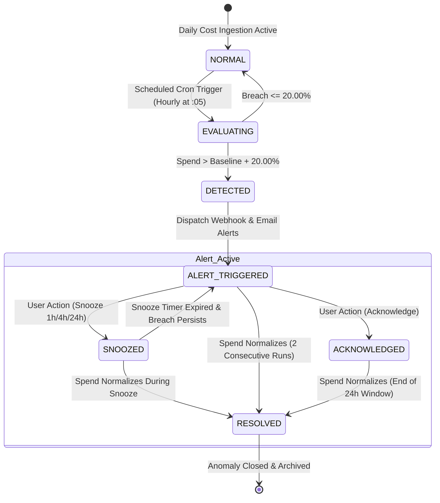

# Product Requirement Document (PRD)
# CloudPulse Analytics Dashboard — Multi-Cloud Telemetry & Cost Anomaly Engine

**Document Reference:** `PRD-CP-2026-009`  
**Parent SRS:** `SRS-CP-2026-009 (v1.2)`  
**Target Release:** Q1 2027 (v1.2.0)  
**PRD Tier:** Standard Tier (Multi-system integration, stateful anomaly lifecycle, RBAC, SOC 2 / ISO 27001 compliance)

---

## 1. Document Control & Executive Summary

### 1.1 Document Metadata & Sign-off

| Attribute | Details |
| :--- | :--- |
| **Document ID** | `PRD-CP-2026-009` |
| **Version** | `1.2.0` |
| **Document Status** | `In Review` |
| **Product Manager / Author** | Product Management Lead |
| **Technical Lead** | CloudPulse Architecture Lead |
| **QA / Test Engineering Lead** | Principal QA Engineer |
| **Compliance & Security Officer** | InfoSec & Compliance Lead (SOC 2 Type II / ISO 27001) |
| **Last Updated** | November 3, 2026 |

### 1.2 PRD Tier Assessment & Justification

* **Selected Tier:** **Standard Tier**
* **Justification:** CloudPulse encompasses 6 primary functional requirements and 4 core non-functional/security specifications across three distributed infrastructure integrations (AWS CloudWatch/Cost Explorer, Google Cloud Monitoring/Cloud Billing, and Enterprise Identity Providers). It enforces a deterministic multi-state lifecycle for cost anomalies (`DETECTED` ➔ `ALERT_TRIGGERED` ➔ `ACKNOWLEDGED` / `SNOOZED` ➔ `RESOLVED`), role-based access control (RBAC), and SOC 2 Type II / ISO 27001 compliance for encrypted credential storage and immutable audit logging.

### 1.3 Problem Statement
Modern engineering organizations operate distributed multi-cloud workloads across Amazon Web Services (AWS) and Google Cloud Platform (GCP). Infrastructure teams face two critical operational bottlenecks:
1. **Telemetry Fragmentation:** DevOps engineers waste 20–40 minutes context-switching between AWS CloudWatch and GCP Cloud Monitoring to diagnose cross-cloud latency and resource bottlenecks.
2. **Delayed Cost Anomaly Detection:** FinOps managers typically discover runaway compute or database billing spikes 24–72 hours after initial deployment, resulting in thousands of dollars in unbudgeted cloud expenditure before manual remediation occurs.

CloudPulse provides a single-pane-of-glass real-time telemetry streaming dashboard combined with an automated, threshold-based cost anomaly engine to compress detection and notification from days to under 60 seconds.

### 1.4 Success Metrics (KPIs)

| Category | Metric | Baseline | Target (v1.2) | Measurement Mechanism |
| :--- | :--- | :--- | :--- | :--- |
| **North-Star Metric** | Mean Time to Detect Cost Anomaly (MTTD) | 28 hours | **< 15 minutes** | Evaluator timestamp delta from billing telemetry ingestion |
| **Operational Metric** | Telemetry Dashboard Refresh Latency | 60 seconds | **≤ 15 seconds** | Client-side WebSocket/polling event monitor |
| **Operational Metric** | UI Load Time (p95) | 4.2 seconds | **< 1.5 seconds** | Real User Monitoring (RUM) & Datadog APM |
| **Operational Metric** | Ingestion Pipeline Throughput | 10k events/sec | **≥ 50,000 events/sec** | Kafka consumer lag & ingress throughput metric |
| **Guardrail Metric** | Alert Delivery Delay | 5–10 minutes | **< 60 seconds** | Time from breach calculation to webhook/email dispatch |
| **Guardrail Metric** | Ingestion Packet Drop Rate | 0.05% | **0.00% (Zero Drops)** | Ingestion dead-letter queue count |
| **Security Metric** | Unencrypted Credential Exposures | 0 | **0 (Strict Zero Tolerance)** | Automated secret scanner & audit log review |

### 1.5 Scope Boundaries

#### In-Scope (P0 / P1)
- Single Sign-On (SSO) integration via SAML 2.0 (Okta) and OAuth2 / OIDC (Google Workspace) [`P0`].
- Enforced Multi-Factor Authentication (MFA) via TOTP (RFC 6238) / WebAuthn for Admin and FinOps roles [`P0`].
- Real-time CPU, RAM, and Network I/O dashboard with automated refresh ≤ 15 seconds [`P0`].
- Multi-dimensional filtering by Cloud Provider (AWS, GCP), Region, Service Type (EC2, S3, GKE), and custom tag key:value pairs [`P0`].
- Automated daily spend anomaly evaluator triggering webhook and email alerts when spend exceeds user threshold by > 20% [`P0`].
- Interactive notification center supporting `Acknowledge` and `Snooze` (1h, 4h, 24h) lifecycle actions [`P1`].
- AES-256-GCM envelope encryption for cloud provider read tokens and TLS 1.3 in-transit enforcement [`P0`].
- Immutable audit log recording all credential changes, anomaly state transitions, and privileged logins [`P0`].

#### Out-of-Scope (Explicit Non-Goals for v1.2)
- Automated write-back remediation (e.g., automatically terminating EC2 instances or stopping GKE pods).
- Support for Microsoft Azure, Oracle Cloud Infrastructure (OCI), or on-premise private clouds (targeted for v2.0).
- Payment gateway processing, multi-currency conversion, or automated invoice generation.
- Custom machine-learning forecasting models (v1.2 enforces deterministic threshold rules against rolling historical baselines).

---

## 2. User Personas, System Actors & Permissions

### 2.1 Personas & System Actors

| Actor | Type | Description & Primary Objectives |
| :--- | :--- | :--- |
| **DevOps Engineer** | Human | Needs low-latency, unified infrastructure monitoring across AWS and GCP to diagnose service degradation and inspect instance metrics. |
| **FinOps Manager** | Human | Monitors aggregate cloud expenditure across cost centers, configures anomaly alert thresholds, snoozes known spikes (e.g., load tests), and exports audit reports. |
| **System Administrator** | Human | Configures enterprise SSO, provisions API read tokens for AWS/GCP, enforces MFA policies, and monitors audit logs. |
| **Cloud Telemetry Ingestor** | System | Read-only background daemon polling AWS CloudWatch and GCP Cloud Monitoring metrics at 15-second intervals. |
| **Cloud Billing Collector** | System | Scheduled ingestion worker pulling AWS Cost Explorer and GCP Cloud Billing daily cost summaries. |
| **Anomaly Evaluator Engine** | System | Stateful stream worker comparing incoming spend telemetry against configured baseline thresholds. |
| **Notification Dispatcher** | System | Reliable event worker delivering HMAC-signed webhooks and SMTP email alerts with exponential backoff. |

### 2.2 Role-Based Access Control (RBAC) & Permission Matrix

| Resource / Action | System Administrator | FinOps Manager | DevOps Engineer | Read-Only Viewer |
| :--- | :---: | :---: | :---: | :---: |
| **View Telemetry Dashboard** | Allowed | Allowed | Allowed | Allowed |
| **Apply Metric Filters (Region/Tag)** | Allowed | Allowed | Allowed | Allowed |
| **Configure Anomaly Thresholds** | Allowed | Allowed | Denied (`403`) | Denied (`403`) |
| **Acknowledge / Snooze Anomalies** | Allowed | Allowed | Allowed | Denied (`403`) |
| **Manage Cloud Read Credentials** | Allowed | Denied (`403`) | Denied (`403`) | Denied (`403`) |
| **Configure SSO / MFA Policies** | Allowed | Denied (`403`) | Denied (`403`) | Denied (`403`) |
| **View Unmasked Audit Logs** | Allowed | Allowed (Spend only) | Denied (`403`) | Denied (`403`) |
| **Export CSV / PDF Spend Reports** | Allowed | Allowed | Denied (`403`) | Denied (`403`) |

---

## 3. Functional Requirements & Deterministic Rules

### Module 1: Authentication, Authorization & Identity

#### REQ-AUTH-01: Enterprise Single Sign-On (SSO) Integration [`P0 — Must Have`]
* **Functional Contract:**
  1. The system shall support identity federation using **SAML 2.0** (specifically certified for Okta) and **OAuth2 / OIDC** (Google Workspace).
  2. Just-In-Time (JIT) provisioning shall create local user accounts upon valid IdP assertion if the user’s domain matches the organization’s verified enterprise domain.
  3. Session authentication tokens shall use encrypted, signed JWTs (RS256) with a deterministic time-to-live (TTL) of **28,800 seconds (8 hours)**.
* **Deterministic Validation & IdP Rules:**
  - SAML assertions must include valid `NameID` (email), `givenName`, `surname`, and `groups`.
  - Clock skew between IdP timestamp and CloudPulse server time must not exceed **±60 seconds**.
  - Replay prevention: Assertion `ID` must be checked against a distributed Redis cache with TTL = 300 seconds; duplicate IDs must be rejected immediately.
* **Error Handling:**
  - If SAML assertion is expired or signature invalid: Return HTTP `401 Unauthorized`, error code `AUTH_SAML_INVALID_SIGNATURE`, user message: *"Single Sign-On authentication failed. Please contact your administrator."* Emit audit log with source IP and IdP issuer.

#### REQ-AUTH-02: Enforced Multi-Factor Authentication (MFA) [`P0 — Must Have`]
* **Functional Contract:**
  1. The system shall strictly enforce MFA verification for all accounts assigned the `System Administrator` or `FinOps Manager` roles.
  2. Supported MFA factors: **TOTP** (RFC 6238, 6-digit code, 30-second window, HMAC-SHA1) and **FIDO2 / WebAuthn**.
  3. A user without MFA enrolled who is assigned a privileged role must be routed to a mandatory MFA enrollment step before any API or UI access is granted.
* **Deterministic Business Logic:**
  - TOTP verification allows a drift window of **±1 step (30 seconds)** to accommodate client clock variations.
  - Rate limiting: **5 consecutive failed MFA attempts within 5 minutes** locks the account for **15 minutes**.
  - Recovery: Generation of 8 single-use, 10-character alphanumeric backup codes hashed with bcrypt (cost factor = 12).
* **Error Handling:**
  - Invalid TOTP code: Return HTTP `401 Unauthorized`, error code `AUTH_MFA_INVALID_TOKEN`, display: *"Invalid verification code. Please try again."*
  - Account lockout: Return HTTP `423 Locked`, error code `AUTH_ACCOUNT_LOCKED_MFA_ATTEMPTS`, display: *"Account temporarily locked due to multiple failed verification attempts. Please retry in 15 minutes."*

---

### Module 2: Real-Time Infrastructure Monitoring

#### REQ-MON-01: Multi-Cloud Telemetry Ingestion & Real-Time Dashboard [`P0 — Must Have`]
* **Functional Contract:**
  1. The dashboard shall aggregate and render CPU utilization (%), Memory utilization (%), and Network I/O (Bytes In / Bytes Out per second) across AWS and GCP instances.
  2. Data ingestion and UI widget updates must maintain a refresh interval **not exceeding 15 seconds** (`refresh_interval <= 15s`).
  3. UI shall establish a Server-Sent Events (SSE) or WebSocket connection for streaming updates; if the streaming connection terminates, the client shall fall back to HTTP polling every 15 seconds (`interval = 15,000ms`).
* **Deterministic Calculation & Aggregation Rules:**
  - CPU Utilization: Represented as a percentage rounded to 2 decimal places (`0.00%` to `100.00%`).
  - Memory Utilization: `(Used Memory Bytes / Total Provisioned Bytes) * 100`, rounded to 2 decimal places.
  - Network I/O: Instantaneous delta `(Bytes_t - Bytes_{t-1}) / (t - t-1)`, rendered in KB/s, MB/s, or GB/s using binary IEC standards (1024 basis).
  - Out-of-order metric deduplication: Events with identical `(provider, account_id, resource_id, metric_name, timestamp)` must be discarded.
* **Error & Degradation Handling:**
  - If AWS CloudWatch or GCP Monitoring API returns HTTP `429 Too Many Requests` or times out (> 5 seconds):
    - System enters degraded mode, serves cached telemetry (maximum cache TTL = 60 seconds), and displays a non-blocking UI badge: *"Telemetry delayed: Cloud provider rate-limited. Retrying..."*
    - Emits internal alarm `INGESTION_PROVIDER_THROTTLED`.

#### REQ-MON-02: Dimensional Filtering & Tag Query Engine [`P0 — Must Have`]
* **Functional Contract:**
  1. The telemetry dashboard shall allow dynamic filtering across three simultaneous dimensions:
     - **Cloud Region:** AWS regions (e.g., `us-east-1`, `eu-west-1`) and GCP regions (e.g., `us-central1`, `europe-west3`).
     - **Service Type:** AWS EC2, AWS S3, GCP GKE, GCP Cloud SQL.
     - **Custom Tags:** Exact key-value matching (e.g., `environment:production`, `cost-center:finops-core`).
  2. Filtering must execute client-side for loaded cached metrics (< 50ms) and server-side for historical range queries (< 500ms).
* **Deterministic Filter Semantics:**
  - Intra-dimension logic: Disjunctive (`OR`). Selecting regions `us-east-1` and `us-central1` includes resources in either region.
  - Inter-dimension logic: Conjunctive (`AND`). Selecting Region: `us-east-1` AND Service: `EC2` AND Tag: `env:prod` returns only EC2 instances in `us-east-1` bearing the `env:prod` tag.
  - Tag key/value sanitization: Strips leading/trailing whitespace, supports UTF-8, maximum key length 128 characters, maximum value length 256 characters.

---

### Module 3: Cost Anomaly Detection & Alert Dispatch

#### REQ-COST-01: Daily Spend Anomaly Detection & Dispatch [`P0 — Must Have`]
* **Functional Contract:**
  1. The system shall evaluate cumulative daily cloud spending per cloud account every hour at minute 05 (`05 * * * *`).
  2. An anomaly alert shall be triggered if the current projected or realized daily spend exceeds the baseline spending threshold by **strictly greater than 20.00%** (`breach_percentage > 20.00%`).
  3. Upon breach detection, the system shall simultaneously dispatch:
     - An email alert via SMTP to registered FinOps / Admin distribution lists.
     - An HTTP POST webhook payload signed with an HMAC-SHA256 signature to customer-configured endpoints.
* **Deterministic Business Logic & Calculation Formula:**
  - **Baseline Spending ($B$):** Either user-configured static budget limit ($T_{static}$) OR the 14-day rolling trimmed mean of daily spend excluding the top 10% outliers ($T_{rolling}$), configured per account.
  - **Current Projected Daily Spend ($S_{proj}$):**
    $$S_{proj} = \frac{S_{accumulated}}{CurrentHourOfDay} \times 24$$ (calculated after 04:00 UTC).
  - **Breach Condition:**
    $$\Delta\% = \left(\frac{S_{proj} - B}{B}\right) \times 100 > 20.00\%$$
  - **Monetary Precision:** All currency amounts stored as `DECIMAL(19,4)` in USD. Display values rounded to 2 decimal places using `ROUND_HALF_EVEN` (Banker's rounding).
  - **Alert Debounce Rule:** Exactly **one** active anomaly alert per account per 24-hour UTC window unless the spend breaches an additional 20% increment above the previous alert point.
* **Webhook Retry Policy:**
  - Exponential backoff with full jitter: 5 retries at intervals of 30s, 60s, 120s, 240s, 480s.
  - If target endpoint returns non-2xx or times out (> 10 seconds), delivery marked as `RETRYING`. After 5 failures, transitions to `DELIVERY_FAILED` and logs alert.

#### REQ-COST-02: Anomaly Lifecycle Management (Snooze & Acknowledge) [`P1 — High`]
* **Functional Contract:**
  1. Authorized users (`FinOps Manager`, `DevOps Engineer`, `System Administrator`) shall have the ability to acknowledge or snooze active cost anomalies directly from the Notification Center UI or via REST API.
  2. Snooze durations supported: **1 hour**, **4 hours**, **24 hours**, or **Custom DateTime** (up to 7 days maximum).
  3. Every state transition requires a mandatory audit reason string (minimum 10 characters, maximum 500 characters).
* **Deterministic State Rules:**
  - When an anomaly is `SNOOZED`, all subsequent email and webhook notifications for that specific anomaly are suppressed until the snooze expiration timestamp is reached.
  - Upon snooze expiration, if the anomaly condition persists ($\Delta\% > 20.00\%$), the anomaly transitions automatically back to `TRIGGERED` and dispatches a "Snooze Expired — Breach Ongoing" notification.
  - When an anomaly is marked `ACKNOWLEDGED`, alert dispatch stops permanently for that 24-hour cycle.
  - If daily spend drops back to $\le 20.00\%$ of baseline for two consecutive evaluation cycles, the system automatically transitions the anomaly to `RESOLVED`.

---

## 4. State Machine & Flow: Cost Anomaly Lifecycle

### 4.1 State Machine Diagram (Mermaid)



### 4.2 State Transition Table

| Current State | Trigger / Event | Guard Condition | Next State | Side Effects & Actions | Rollback / Failure Action |
| :--- | :--- | :--- | :--- | :--- | :--- |
| `NORMAL` | `CRON_EVALUATE` | None | `EVALUATING` | Worker locks account evaluation row in Redis with 120s TTL | Release Redis lock if worker crashes |
| `EVALUATING` | `BREACH_CALCULATED` | $\Delta\% > 20.00\%$ AND debounce check passes | `DETECTED` | Create `cost_anomalies` record with UUIDv4; status = `DETECTED` | Discard record on DB write failure; re-evaluate next run |
| `DETECTED` | `DISPATCH_ALERTS` | Webhook URL & Email list configured | `ALERT_TRIGGERED` | Enqueue SMTP job; enqueue signed HTTP webhook job | If dispatch queue unreachable, retry queueing up to 3 times |
| `ALERT_TRIGGERED` | `USER_SNOOZE` | User has `FinOps`, `DevOps`, or `Admin` role; audit reason length $\ge 10$ | `SNOOZED` | Set `snoozed_until` timestamp; emit `AuditLog` entry; cancel pending alert retries | Reject with `400 Bad Request` if reason < 10 chars |
| `ALERT_TRIGGERED` | `USER_ACKNOWLEDGE`| User has `FinOps`, `DevOps`, or `Admin` role; audit reason length $\ge 10$ | `ACKNOWLEDGED` | Set `acknowledged_at` timestamp and `acknowledged_by`; emit `AuditLog` entry | Reject with `403 Forbidden` if role unauthorized |
| `SNOOZED` | `TIMER_EXPIRED` | `NOW() >= snoozed_until` AND spend $\Delta\% > 20.00\%$ | `ALERT_TRIGGERED` | Re-enqueue webhook & email alert with flag `resumed_from_snooze: true` | If worker delayed, process immediately on next scheduler tick |
| `ALERT_TRIGGERED` / `SNOOZED` | `COST_NORMALIZED` | Spend $\Delta\% \le 20.00\%$ for 2 consecutive hourly cycles | `RESOLVED` | Set `resolved_at = NOW()`; send "Anomaly Resolved" notification | None (terminal for anomaly instance) |

* **Non-Terminal States:** `EVALUATING`, `DETECTED`, `ALERT_TRIGGERED`, `SNOOZED`.
* **Terminal States:** `RESOLVED`, `ACKNOWLEDGED` (at cycle boundary).
* **Timeout & Reconciliation Rules:**
  - `EVALUATING` has an explicit execution timeout of **180 seconds**. If evaluation does not complete within 180s, the distributed lock expires and an alert `EVALUATION_TIMEOUT_EXCEEDED` is sent to Sentry/Datadog.
  - `DETECTED` must transition to `ALERT_TRIGGERED` within **60 seconds**. A background reconciliation job sweeps any anomaly lingering in `DETECTED` for > 120s and re-enqueues dispatch.

---

## 5. Technical Specifications (API Contracts & Data Models)

### 5.1 API Contracts

#### Endpoint 1: Query Real-Time Telemetry Metrics
* **Method & Path:** `GET /api/v1/metrics/telemetry`
* **Headers:**
  - `Authorization: Bearer <JWT>`
  - `Accept: application/json`
* **Query Parameters:**
  - `provider` (required, string): `aws` | `gcp` | `all`
  - `region` (optional, string): Comma-separated list (e.g. `us-east-1,us-central1`)
  - `services` (optional, string): Comma-separated list (e.g. `ec2,gke`)
  - `tags` (optional, string): Encoded key:value pairs (e.g. `env:prod,tier:frontend`)
  - `interval_seconds` (optional, integer, default: `15`, min: `5`, max: `300`)
* **Response (HTTP `200 OK`):**
```json
{
  "timestamp": "2026-11-03T11:15:00.000Z",
  "provider": "aws",
  "data_points_count": 1,
  "metrics": [
    {
      "resource_id": "i-09ab7c1234ef5678a",
      "resource_name": "checkout-service-worker-01",
      "service_type": "ec2",
      "region": "us-east-1",
      "tags": {
        "env": "production",
        "team": "core-payments"
      },
      "cpu_utilization_pct": 42.15,
      "memory_utilization_pct": 68.40,
      "network_io": {
        "bytes_in_per_sec": 1048576,
        "bytes_out_per_sec": 5242880
      },
      "recorded_at": "2026-11-03T11:14:52.000Z"
    }
  ]
}
```

#### Endpoint 2: Snooze Cost Anomaly
* **Method & Path:** `POST /api/v1/anomalies/{anomaly_id}/snooze`
* **Headers:**
  - `Authorization: Bearer <JWT>`
  - `Content-Type: application/json`
  - `Idempotency-Key: <UUIDv4>`
* **Request Body:**
```json
{
  "duration_hours": 4,
  "reason": "Running scheduled load tests in us-east-1 until 15:00 UTC."
}
```
* **Response (HTTP `200 OK`):**
```json
{
  "anomaly_id": "c7a8e23f-4e12-4f89-91c2-3e5f210d7a01",
  "status": "SNOOZED",
  "snoozed_until": "2026-11-03T15:15:00.000Z",
  "snoozed_by": "usr_998124_finops",
  "audit_log_id": "aud_11823901"
}
```
* **Error Response (HTTP `400 Bad Request`):**
```json
{
  "error_code": "ANOMALY_INVALID_REASON",
  "message": "Reason description must contain at least 10 characters."
}
```

---

### 5.2 Core Data Models

#### Entity 1: `CloudCredential` (Encrypted at Rest)
* `id`: UUID (Primary Key)
* `organization_id`: UUID (Indexed)
* `provider`: Enum (`AWS`, `GCP`)
* `account_id`: VARCHAR(64)
* `encrypted_token_blob`: BYTEA (AES-256-GCM ciphertext)
* `encryption_iv`: BYTEA (12-byte initialization vector)
* `encryption_auth_tag`: BYTEA (16-byte authentication tag)
* `kms_key_arn`: VARCHAR(255) (Reference to AWS KMS or GCP Cloud KMS key)
* `status`: Enum (`ACTIVE`, `REVOKED`, `INVALID_CREDENTIALS`)
* `created_at`: TIMESTAMPTZ (Immutable)
* `updated_at`: TIMESTAMPTZ

#### Entity 2: `CostAnomaly`
* `id`: UUID (Primary Key)
* `organization_id`: UUID (Indexed)
* `cloud_account_id`: VARCHAR(64) (Indexed)
* `evaluation_date`: DATE (Indexed)
* `baseline_amount_usd`: `DECIMAL(19,4)`
* `projected_amount_usd`: `DECIMAL(19,4)`
* `breach_percentage`: `DECIMAL(7,4)`
* `status`: Enum (`DETECTED`, `ALERT_TRIGGERED`, `SNOOZED`, `ACKNOWLEDGED`, `RESOLVED`)
* `snoozed_until`: TIMESTAMPTZ (Nullable)
* `acknowledged_at`: TIMESTAMPTZ (Nullable)
* `acknowledged_by`: UUID (Nullable, foreign key to `users`)
* `resolution_reason`: TEXT (Nullable)
* `lock_version`: INTEGER (Default 0, for optimistic concurrency locking)
* `created_at`: TIMESTAMPTZ
* `updated_at`: TIMESTAMPTZ

#### Entity 3: `AuditLog` (Append-Only, Immutable)
* `id`: BIGSERIAL (Primary Key)
* `organization_id`: UUID (Indexed)
* `actor_user_id`: UUID (Indexed, Nullable for system actors)
* `actor_role`: VARCHAR(32)
* `action`: VARCHAR(64) (`SSO_LOGIN`, `MFA_VERIFY`, `ANOMALY_SNOOZE`, `ANOMALY_ACKNOWLEDGE`, `CREDENTIAL_UPDATE`)
* `resource_type`: VARCHAR(32)
* `resource_id`: VARCHAR(64)
* `client_ip`: INET
* `user_agent`: TEXT
* `payload_hash`: CHAR(64) (SHA-256 hash of mutation payload)
* `created_at`: TIMESTAMPTZ (Default `NOW()`, unalterable)

---

## 6. Compliance & Regulatory Requirements (SOC 2 Type II & ISO 27001)

### 6.1 Regulatory Controls Mapping

| Control Framework | Reference Clause | Required System Capability | CloudPulse PRD Implementation & Enforcement |
| :--- | :--- | :--- | :--- |
| **SOC 2 Type II** | **CC6.1** (Logical Access) | Enforce unique authentication and role restrictions | Handled via `REQ-AUTH-01` (SAML 2.0 / Okta SSO) and Section 2.2 RBAC matrix. Direct password auth prohibited. |
| **SOC 2 Type II** | **CC6.3** (Perimeter & Credential Encryption) | Protect stored credentials and cryptographic keys | Handled via `REQ-SEC-02`: AWS/GCP API read tokens encrypted at rest via **AES-256-GCM** using envelope encryption with Cloud KMS. Secret rotation every 90 days. |
| **SOC 2 Type II** | **CC6.6** / **ISO 27001 A.10.1** | Protect data transmitted over public networks | Handled via `REQ-SEC-01`: All web UI, REST API, WebSocket, and webhook traffic strictly enforced under **TLS 1.3**. HSTS enabled with `max-age=31536000; includeSubDomains`. |
| **SOC 2 Type II** | **CC6.8** / **ISO 27001 A.9.4.2** | Enforce multi-factor authentication for privileged users | Handled via `REQ-AUTH-02`: Mandatory TOTP / WebAuthn MFA for `System Administrator` and `FinOps Manager`. Session invalidation on role change. |
| **SOC 2 Type II** | **CC7.2** / **ISO 27001 A.12.4** | Maintain immutable event logging and audit trails | Handled via Section 5.2 `AuditLog`: Append-only, write-once table. Logs retained for **365 days**. Automated zero-PII and zero-secret redaction in application log streams. |

### 6.2 Compliance Sign-off Block

> [!NOTE]
> This compliance mapping has been evaluated against SOC 2 Type II Trust Services Criteria (Security, Confidentiality) and ISO/IEC 27001:2022 Information Security Controls. Implementation details require review by the designated Information Security Officer prior to production deployment.

* **Compliance Status:** Pending Final Pre-Release Audit Sign-Off
* **Assigned Compliance Officer:** Principal InfoSec Engineer
* **Target Audit Date:** December 15, 2026

---

## 7. Non-Functional Requirements (NFRs) & SLAs

| Category | Metric ID | Target SLA / Threshold | Measurement Method & Validation |
| :--- | :--- | :--- | :--- |
| **Performance** | `NFR-PERF-01` | Dashboard UI load time **< 1.5 seconds (p95)** across 500 concurrent sessions | Automated k6 load tests hitting cached `/api/v1/metrics/telemetry` |
| **Throughput** | `NFR-PERF-02` | Ingestion pipeline ingests **≥ 50,000 metric events/sec** with **0% dropped packets** | Stress test using mock event generator publishing to Kafka ingress |
| **Latency** | `NFR-PERF-03` | Metric refresh interval on UI **≤ 15.0 seconds** | Playwright E2E timer measuring metric DOM updates |
| **Availability** | `NFR-AVAIL-01`| **99.90% monthly uptime** (excluding scheduled maintenance) | Datadog Synthetic multi-region uptime monitors |
| **Disaster Recovery** | `NFR-DR-01` | **RPO ≤ 5 minutes, RTO ≤ 60 minutes** | Bi-annual multi-region database failover drill |
| **Idempotency** | `NFR-IDEMP-01`| 24-hour deduplication window on `Idempotency-Key` headers for anomaly mutations | Integration tests simulating duplicate webhook and snooze calls |
| **Concurrency** | `NFR-CONC-01` | Optimistic locking on anomaly records using `lock_version`; zero lost updates | Multi-threaded test attempting simultaneous snooze actions |
| **Observability** | `NFR-OBS-01` | 100% of HTTP requests and async jobs emit `trace_id`, `span_id`, and `tenant_id` | Log auditing and OpenTelemetry Jaeger collector verification |
| **Alerting** | `NFR-ALERT-01`| Webhook & email alert dispatched within **60 seconds** of breach calculation | Telemetry pipeline timestamp difference validation |

---

## 8. QA Test Matrix

The following test matrix provides complete verification coverage across all five testing categories (Positive, Negative, Boundary, Concurrency/Network, Security/Compliance).

| Test ID | Traced REQ | Category | Scenario / Test Case | Preconditions & Test Data | Execution Steps | Expected System Result & State |
| :--- | :--- | :--- | :--- | :--- | :--- | :--- |
| `QA-AUTH-01` | `REQ-AUTH-01` | Positive | Successful SAML 2.0 SSO login via Okta | Registered enterprise user in Okta directory; matching domain | 1. Initiate login from CloudPulse UI.<br>2. Complete Okta authentication.<br>3. Callback with valid SAML assertion. | User session established; RS256 JWT issued (TTL=8h); audit record `SSO_LOGIN` created; redirect to dashboard. |
| `QA-AUTH-02` | `REQ-AUTH-01` | Security | Replay attack using expired SAML assertion ID | Intercepted SAML assertion with previously used Assertion ID | 1. Post SAML response to `/api/v1/auth/sso/saml/callback` with duplicate Assertion ID. | Request rejected with HTTP `401 Unauthorized`; error `AUTH_SAML_REPLAY_DETECTED`; zero session created. |
| `QA-MFA-01` | `REQ-AUTH-02` | Positive | Mandatory MFA enrollment and challenge for FinOps role | New user assigned `FinOps Manager` role without registered MFA | 1. Log in via SSO.<br>2. Intercept attempt to access spend dashboard.<br>3. Complete TOTP scan & enter valid code. | User forced to `/mfa-setup`; backup codes generated; upon valid TOTP, access granted to FinOps modules. |
| `QA-MFA-02` | `REQ-AUTH-02` | Negative | Account lockout after 5 consecutive failed MFA attempts | User with `Admin` role and active TOTP | 1. Enter incorrect 6-digit TOTP code 5 consecutive times within 3 minutes. | 5th attempt returns HTTP `423 Locked`; error `AUTH_ACCOUNT_LOCKED_MFA_ATTEMPTS`; account locked for 15 min. |
| `QA-MON-01` | `REQ-MON-01` | Positive | Real-time metric streaming updates within 15 seconds | Connected AWS & GCP test accounts streaming live metrics | 1. Open dashboard.<br>2. Observe telemetry charts.<br>3. Record timestamp of DOM updates over 5 minutes. | CPU/RAM/Network metrics update every $\le 15.0$ seconds via SSE/WebSocket without requiring full-page reload. |
| `QA-MON-02` | `REQ-MON-01` | Concurrency | Pipeline stress test under 50,000 events/second ingress | Load generator emitting 50k mock telemetry events/sec | 1. Sustain 50k events/sec for 15 minutes.<br>2. Monitor consumer lag and drop rate counter. | Zero dropped packets (0.00%); consumer lag stays under 500ms; UI load time remains $< 1.5$ seconds (p95). |
| `QA-MON-03` | `REQ-MON-01` | Network | Graceful degradation on AWS CloudWatch API 429 throttling | Mock AWS SDK client configured to return HTTP `429` | 1. Trigger metric refresh while AWS API returns 429.<br>2. Inspect client UI state. | System displays cached metrics; non-blocking badge displayed; zero crash; automatic recovery upon 200 OK. |
| `QA-FILT-01` | `REQ-MON-02` | Positive | Multi-dimensional filter by Provider, Region, and Tag | Telemetry store containing multi-region AWS and GCP nodes | 1. Select Provider: `AWS`, Region: `us-east-1`, Tag: `env:prod`.<br>2. Verify rendered nodes. | Exactly matches conjunctive `AND` logic; only EC2 nodes in `us-east-1` with `env:prod` are displayed. |
| `QA-FILT-02` | `REQ-MON-02` | Boundary | Tag filter with maximum allowable key/value length | Node tagged with 128-char key and 256-char value | 1. Apply filter using 128-char key and 256-char value.<br>2. Execute query. | Filter parses successfully; query executes without SQL/memory error; matching node returned within 500ms. |
| `QA-COST-01` | `REQ-COST-01` | Positive | Anomaly trigger and notification on spend > 20.00% | Daily baseline = $1,000.00; projected spend = $1,250.00 (+25.00%) | 1. Trigger scheduled evaluator at 05:00 UTC.<br>2. Verify anomaly created and alerts sent. | Anomaly record created with state `ALERT_TRIGGERED`; SMTP email sent; HMAC-signed webhook delivered within 60s. |
| `QA-COST-02` | `REQ-COST-01` | Boundary | Exact boundary spend comparison at 20.00% threshold | Daily baseline = $1,000.00; projected spend = $1,200.00 (+20.0000%) | 1. Run evaluator with spend at exactly +20.00%.<br>2. Check anomaly status. | No anomaly triggered (rule requires strictly $> 20.00\%$). System remains in `NORMAL` state. |
| `QA-COST-03` | `REQ-COST-01` | Network | Webhook target endpoint failure and exponential retry | Webhook receiver configured to return HTTP `503 Service Unavailable` | 1. Anomaly detected.<br>2. Webhook dispatcher attempts delivery to failing endpoint. | Dispatcher retries 5 times with exponential backoff (30s, 60s, 120s, 240s, 480s); logs `DELIVERY_FAILED` after 5th try. |
| `QA-SNOOZ-01`| `REQ-COST-02` | Positive | Snooze anomaly for 4 hours with valid audit reason | Active anomaly in `ALERT_TRIGGERED` state | 1. FinOps user posts snooze for 4h with reason: "Load test underway."<br>2. Verify anomaly state. | Anomaly transitions to `SNOOZED`; notifications suppressed; audit log record created with actor ID and timestamp. |
| `QA-SNOOZ-02`| `REQ-COST-02` | Negative | Snooze rejected when reason string is under 10 characters | Active anomaly in `ALERT_TRIGGERED` state | 1. Post snooze request with reason = "Testing". | Returns HTTP `400 Bad Request`; error `ANOMALY_INVALID_REASON`; state remains `ALERT_TRIGGERED`. |
| `QA-SNOOZ-03`| `REQ-COST-02` | Concurrency | Concurrent snooze requests with identical idempotency key | Active anomaly in `ALERT_TRIGGERED` state | 1. Send two simultaneous snooze requests within 5ms using same `Idempotency-Key`. | Exactly one request executes state change; second request returns cached `200 OK` without duplicate audit log. |
| `QA-SEC-01`  | `REQ-SEC-01`  | Security | TLS 1.3 enforcement and rejection of TLS 1.2 and plaintext | CloudPulse API gateway endpoint | 1. Attempt connection using TLS 1.1 and TLS 1.2.<br>2. Attempt connection with TLS 1.3. | TLS 1.1 and 1.2 handshakes terminated with connection error; only TLS 1.3 connection accepted. |
| `QA-SEC-02`  | `REQ-SEC-02`  | Security | Verification of AES-256-GCM encryption at rest | Cloud credentials stored in database | 1. Inspect raw DB row in `cloud_credentials`.<br>2. Inspect application memory dumps and server logs. | Raw token is binary ciphertext; zero plaintext secrets in database; zero tokens printed in logs or APM traces. |

---

## 9. Rollout Strategy & Open Questions

### 9.1 Phased Rollout Plan

```
┌─────────────────┐     ┌─────────────────┐     ┌─────────────────┐     ┌─────────────────┐
│ Phase 1: Canary │ ──> │ Phase 2: Staged │ ──> │ Phase 3: Broad  │ ──> │ Phase 4: Full   │
│ 5% of Accounts  │     │ 25% of Accounts │     │ 50% of Accounts │     │ 100% General    │
│ Duration: 7 days│     │ Duration: 7 days│     │ Duration: 5 days│     │ Availability    │
└─────────────────┘     └─────────────────┘     └─────────────────┘     └─────────────────┘
```

* **Feature Flags Managed via LaunchDarkly:**
  - `auth_sso_saml_v1`: Gates Okta SAML 2.0 authentication provider.
  - `monitoring_streaming_telemetry_v1`: Controls 15s WebSocket/SSE streaming pipeline.
  - `cost_anomaly_evaluator_v1`: Enables hourly cron evaluator and notification dispatch.
* **Automated Rollback & Kill-Switch Criteria:**
  - Ingestion packet drop rate $> 0.001\%$ over any 5-minute rolling window.
  - Dashboard load time p95 exceeds **2,500ms** for $> 1\%$ of active users.
  - Sentry / Datadog 5xx error rate on metric API exceeds **0.50%**.
  - Any detected plaintext credential exposure in application logs automatically trips the master integration kill-switch.

### 9.2 Assumptions & Open Questions Log

| ID | Category | Assumption / Question | Impact if Wrong | Owner | Target Due Date |
| :--- | :--- | :--- | :--- | :--- | :--- |
| `ASM-001` | Scale | AWS CloudWatch API quota is sufficient to poll 500 instances at 15s intervals without exceeding default account limits. | High — Requires AWS Support quota increase or switching to CloudWatch Metric Streams via Kinesis. | Infra Lead | Nov 15, 2026 |
| `ASM-002` | Product | 14-day rolling trimmed mean is an acceptable default baseline for organizations without a static budget set. | Medium — May cause alert noise for accounts with naturally volatile day-of-week spend patterns. | FinOps PM | Nov 20, 2026 |
| `ASM-003` | Security | Okta tenant certificate rotation does not require automated SAML metadata polling in v1.2 (manual cert upload acceptable). | Low — If automated rotation required, must add automated IdP metadata XML polling scheduler. | SecOps Lead | Nov 22, 2026 |

---

## 10. Agile User Story Decomposition (INVEST Slices)

### 10.1 Executive Story Mapping Table

| Story ID | Epic / Module | User Story Title | Traced REQ | Traced QA | Sizing | Dependencies |
| :--- | :--- | :--- | :--- | :--- | :--- | :--- |
| `US-AUTH-101` | Authentication | Enterprise SAML 2.0 & OAuth2 SSO Login Flow | `REQ-AUTH-01` | `QA-AUTH-01`, `QA-AUTH-02` | 5 pts (M) | None |
| `US-AUTH-102` | Authentication | Enforced MFA Enrollment & Challenge for Admin & FinOps | `REQ-AUTH-02` | `QA-MFA-01`, `QA-MFA-02` | 5 pts (M) | `US-AUTH-101` |
| `US-MON-103`  | Telemetry | Multi-Cloud Real-Time Telemetry Dashboard (15s Refresh) | `REQ-MON-01`, `REQ-NFR-01`, `REQ-NFR-02` | `QA-MON-01`, `QA-MON-02`, `QA-MON-03` | 8 pts (L) | None |
| `US-MON-104`  | Telemetry | Multi-Dimensional Filter Engine (Region, Service, Tags) | `REQ-MON-02` | `QA-FILT-01`, `QA-FILT-02` | 5 pts (M) | `US-MON-103` |
| `US-COST-105` | Cost Analytics| Automated Daily Spend Anomaly Detection & Dispatch | `REQ-COST-01`, `REQ-SEC-01`, `REQ-SEC-02` | `QA-COST-01`, `QA-COST-02`, `QA-COST-03`, `QA-SEC-01` | 8 pts (L) | `US-AUTH-101` |
| `US-COST-106` | Cost Analytics| Notification Center Anomaly Lifecycle: Acknowledge & Snooze | `REQ-COST-02` | `QA-SNOOZ-01`, `QA-SNOOZ-02`, `QA-SNOOZ-03` | 5 pts (M) | `US-COST-105` |

---

### 10.2 Detailed Story Specifications

#### US-AUTH-101: Enterprise SAML 2.0 & OAuth2 SSO Login Flow
- **As a** DevOps Engineer or FinOps Manager
- **I want to** authenticate into CloudPulse via our corporate Okta SAML 2.0 or Google Workspace SSO
- **So that** I don't need to manage separate application passwords and our IT team maintains centralized access control.

**Metadata & Traceability:**
- **Module / Epic:** Authentication & Identity
- **Traced Requirements:** `REQ-AUTH-01`
- **Traced NFRs / Security:** `REQ-SEC-01` (TLS 1.3), `NFR-AVAIL-01`
- **Traced QA Tests:** `QA-AUTH-01`, `QA-AUTH-02`
- **Complexity Sizing:** 5 Story Points (Medium)
- **Preconditions / Blockers:** Enterprise domain verified in organization settings.

**Acceptance Criteria (Gherkin):**
```gherkin
Scenario: Successful SAML 2.0 SSO authentication via Okta
  Given an enterprise user belongs to a domain with Okta SSO configured
  When the user initiates login and provides valid Okta identity credentials
  Then the system verifies the SAML assertion signature and clock skew within 60 seconds
  And issues a signed RS256 JWT with an 8-hour expiry
  And records an immutable audit log entry "SSO_LOGIN"
  And redirects the user to the CloudPulse dashboard within 1.5 seconds

Scenario: Rejection of replayed SAML assertion
  Given an authenticated SAML assertion has already been processed by CloudPulse
  When an attacker submits the identical Assertion ID to "/api/v1/auth/sso/saml/callback"
  Then the system detects the duplicate ID in the distributed cache
  And returns HTTP 401 Unauthorized with code "AUTH_SAML_REPLAY_DETECTED"
  And records a security alert log with the client IP address
```

**Technical & Operational Notes:**
- **Feature Flag:** `auth_sso_saml_v1`
- **State Transition:** `UNAUTHENTICATED` ➔ `AUTHENTICATED`
- **Side Effects:** Issues 8-hour JWT cookie; writes to `AuditLog`; checks Redis replay cache.

---

#### US-AUTH-102: Enforced MFA Enrollment & Challenge for Admin & FinOps Roles
- **As a** System Administrator or FinOps Manager
- **I want to** be prompted for a TOTP verification code during login and forced to register MFA if not enrolled
- **So that** privileged financial and administrative capabilities are shielded from credential compromise.

**Metadata & Traceability:**
- **Module / Epic:** Authentication & Identity
- **Traced Requirements:** `REQ-AUTH-02`
- **Traced NFRs / Security:** SOC 2 CC6.8, ISO 27001 A.9.4.2
- **Traced QA Tests:** `QA-MFA-01`, `QA-MFA-02`
- **Complexity Sizing:** 5 Story Points (Medium)
- **Preconditions / Blockers:** `US-AUTH-101` completed.

**Acceptance Criteria (Gherkin):**
```gherkin
Scenario: Forced MFA enrollment on first login for privileged role
  Given an enterprise user has been granted the "FinOps Manager" role
  And the user has not yet registered an MFA factor
  When the user authenticates via SSO
  Then the system restricts access to all dashboard APIs
  And displays the mandatory MFA enrollment screen with a QR code and secret key
  When the user inputs a valid 6-digit TOTP code
  Then the system registers the TOTP factor, generates 8 backup codes, and grants access

Scenario: Temporary account lockout after 5 consecutive invalid MFA entries
  Given a user is on the MFA verification prompt
  When the user submits 5 consecutive incorrect TOTP codes within 5 minutes
  Then the system locks the account for 15 minutes
  And returns HTTP 423 Locked with error code "AUTH_ACCOUNT_LOCKED_MFA_ATTEMPTS"
  And logs an audit event "MFA_LOCKOUT"
```

**Technical & Operational Notes:**
- **Feature Flag:** `auth_mfa_enforcement_v1`
- **State Transition:** `PRE_MFA_AUTHENTICATED` ➔ `MFA_VERIFIED` (or `LOCKED`)
- **Side Effects:** Stores bcrypt-hashed backup codes in DB; sets Redis failure counter.

---

#### US-MON-103: Multi-Cloud Real-Time Telemetry Dashboard (15s Refresh)
- **As a** DevOps Engineer
- **I want to** view CPU, RAM, and Network I/O metrics across AWS and GCP instances with updates ≤ 15 seconds
- **So that** I can detect infrastructure performance bottlenecks in real time from a single dashboard.

**Metadata & Traceability:**
- **Module / Epic:** Real-Time Monitoring
- **Traced Requirements:** `REQ-MON-01`
- **Traced NFRs / Security:** `NFR-PERF-01` (< 1.5s load), `NFR-PERF-02` (50k events/sec), `NFR-PERF-03` (≤ 15s)
- **Traced QA Tests:** `QA-MON-01`, `QA-MON-02`, `QA-MON-03`
- **Complexity Sizing:** 8 Story Points (Large)
- **Preconditions / Blockers:** Valid AWS / GCP read credentials registered.

**Acceptance Criteria (Gherkin):**
```gherkin
Scenario: Real-time telemetry streaming update
  Given an active session on the CloudPulse telemetry dashboard
  When 15 seconds elapse
  Then the client receives the latest metric snapshot via SSE/WebSocket
  And the CPU, RAM, and Network I/O charts update smoothly without a page reload
  And client-side render completion takes less than 200 milliseconds

Scenario: Fallback to polling when SSE connection drops
  Given a user is streaming telemetry metrics via Server-Sent Events
  When the network connection drops the SSE channel
  Then the client automatically initiates HTTP polling every 15,000 milliseconds
  And attempts background reconnection of the SSE stream using exponential backoff
```

**Technical & Operational Notes:**
- **Feature Flag:** `monitoring_streaming_telemetry_v1`
- **State Transition:** `DISCONNECTED` ➔ `STREAMING` (or `POLLING_FALLBACK`)
- **Side Effects:** Emits metric points to client SSE buffer; updates client memory cache.

---

#### US-MON-104: Multi-Dimensional Filter Engine (Region, Service, Tags)
- **As a** DevOps Engineer or FinOps Manager
- **I want to** filter telemetry metrics simultaneously by cloud region, service type, and custom tags
- **So that** I can isolate performance and cost anomalies to specific microservices or deployment environments.

**Metadata & Traceability:**
- **Module / Epic:** Real-Time Monitoring
- **Traced Requirements:** `REQ-MON-02`
- **Traced NFRs / Security:** `NFR-PERF-01`
- **Traced QA Tests:** `QA-FILT-01`, `QA-FILT-02`
- **Complexity Sizing:** 5 Story Points (Medium)
- **Preconditions / Blockers:** `US-MON-103` completed.

**Acceptance Criteria (Gherkin):**
```gherkin
Scenario: Filtering metrics across multiple compound dimensions
  Given the telemetry dashboard is rendering metrics from AWS and GCP
  When the user selects Region "us-east-1", Service "EC2", and Tag "env:production"
  Then the dashboard renders only EC2 instances located in us-east-1 with the env:production tag
  And updates the chart views within 50 milliseconds for currently loaded data

Scenario: Handling empty filter results gracefully
  Given the user applies a tag filter "env:non-existent"
  When no instances match the applied criteria
  Then the dashboard displays an empty-state message: "No instances found matching the selected filters"
  And provides a one-click button to reset active filters
```

**Technical & Operational Notes:**
- **Feature Flag:** `monitoring_filtering_engine_v1`
- **State Transition:** `UNFILTERED_VIEW` ➔ `FILTERED_VIEW`
- **Side Effects:** Updates URL search query params for shareable deep links.

---

#### US-COST-105: Automated Daily Spend Anomaly Detection & Dispatch
- **As a** FinOps Manager
- **I want to** receive immediate email and webhook notifications when daily cloud spend breaches our baseline by > 20%
- **So that** our team can stop accidental cloud cost runaways before they impact monthly budgets.

**Metadata & Traceability:**
- **Module / Epic:** Cost Anomaly Alerts
- **Traced Requirements:** `REQ-COST-01`
- **Traced NFRs / Security:** `REQ-SEC-01`, `REQ-SEC-02`, `NFR-ALERT-01` (< 60s alert delivery)
- **Traced QA Tests:** `QA-COST-01`, `QA-COST-02`, `QA-COST-03`, `QA-SEC-01`, `QA-SEC-02`
- **Complexity Sizing:** 8 Story Points (Large)
- **Preconditions / Blockers:** `US-AUTH-101` completed; cloud billing ingestion active.

**Acceptance Criteria (Gherkin):**
```gherkin
Scenario: Spend breach triggers email and webhook notifications
  Given an account has a 14-day rolling baseline of $1,000.00 USD
  When hourly spend evaluation projects daily spend of $1,250.00 USD (a 25.00% breach)
  Then the system records an anomaly in state "ALERT_TRIGGERED"
  And dispatches an SMTP email alert containing the breach amount and contributing services
  And posts an HMAC-SHA256 signed JSON payload to the configured webhook URL within 60 seconds

Scenario: Webhook delivery failure and exponential backoff
  Given a cost anomaly alert has been triggered
  When the customer webhook endpoint responds with HTTP 500 or times out
  Then the notification worker retries delivery up to 5 times at intervals of 30s, 60s, 120s, 240s, 480s
  And marks the notification status as "DELIVERY_FAILED" if all 5 retries fail
```

**Technical & Operational Notes:**
- **Feature Flag:** `cost_anomaly_evaluator_v1`
- **State Transition:** `NORMAL` ➔ `EVALUATING` ➔ `ALERT_TRIGGERED`
- **Side Effects:** DB write to `CostAnomaly`; enqueues SMTP and webhook jobs; signs payload with tenant secret.

---

#### US-COST-106: Notification Center Anomaly Lifecycle: Acknowledge & Snooze
- **As a** FinOps Manager or DevOps Engineer
- **I want to** acknowledge or snooze active cost anomalies directly from the Notification Center
- **So that** expected spend spikes (such as load tests) do not trigger repetitive alerts.

**Metadata & Traceability:**
- **Module / Epic:** Cost Anomaly Alerts
- **Traced Requirements:** `REQ-COST-02`
- **Traced NFRs / Security:** `NFR-CONC-01` (optimistic locking), `NFR-IDEMP-01`
- **Traced QA Tests:** `QA-SNOOZ-01`, `QA-SNOOZ-02`, `QA-SNOOZ-03`
- **Complexity Sizing:** 5 Story Points (Medium)
- **Preconditions / Blockers:** `US-COST-105` completed.

**Acceptance Criteria (Gherkin):**
```gherkin
Scenario: Snoozing an active anomaly for 4 hours with audit justification
  Given an anomaly is displayed in the Notification Center with state "ALERT_TRIGGERED"
  When the FinOps user selects "Snooze for 4 hours" and enters reason "Running load test for release v1.2"
  Then the system transitions the anomaly state to "SNOOZED"
  And suppresses all alert dispatches until the 4-hour snooze expires
  And creates an immutable entry in the audit log with actor ID, reason, and timestamp

Scenario: Rejection of snooze action with insufficient explanation
  Given an active anomaly in state "ALERT_TRIGGERED"
  When a user submits a snooze request with a reason string containing fewer than 10 characters
  Then the system rejects the mutation with HTTP 400 Bad Request
  And displays an error: "Reason description must contain at least 10 characters."
  And the anomaly remains in state "ALERT_TRIGGERED"
```

**Technical & Operational Notes:**
- **Feature Flag:** `cost_anomaly_lifecycle_v1`
- **State Transition:** `ALERT_TRIGGERED` ➔ `SNOOZED` (or `ACKNOWLEDGED`)
- **Side Effects:** Updates `CostAnomaly.status` and `snoozed_until`; writes audit log; uses optimistic locking.

---

### 10.3 Confirmed Definition of Done (DoD) Quality Gates

The following quality checklist has been confirmed and must be satisfied by every engineering team before any user story is accepted into `Done`:

- [ ] **Unit & Integration Test Coverage:** Unit test code coverage $\ge 80\%$ on all new business logic; integration tests pass against mocked AWS/GCP provider APIs.
- [ ] **Gherkin Acceptance Verification:** All positive, negative, and edge-case Gherkin scenarios verified and passing in the staging environment.
- [ ] **Distributed Observability:** Telemetry tags (`trace_id`, `span_id`, `tenant_id`, and standard error codes) emitted across all HTTP requests and async jobs.
- [ ] **Zero Unmasked Secret / PII Leakage:** Zero AWS access keys, GCP service account JSON tokens, or user passwords printed in application logs, database plaintext, or APM traces.
- [ ] **Feature Flag Dual Verification:** Story functionality verified working both with the designated feature flag enabled (`ON`) and cleanly bypassed when disabled (`OFF`).
- [ ] **API Contract & Schema Compatibility:** All new or updated REST endpoints conform to OpenAPI 3.0 specs and maintain strict backward compatibility.
